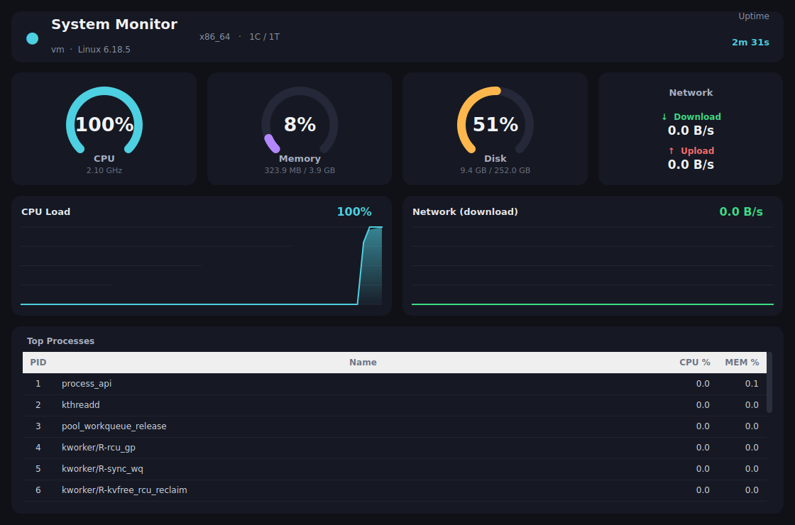

# 💻 SystemMonitor — Modern Qt Desktop Hardware & Resource Dashboard

<p align="center">
  
  
  
  
  
  
</p>

<p align="center">
  <b>SystemMonitor</b> — эстетичный, плавный и легковесный десктопный монитор системных ресурсов на базе <b>Python + PySide6 (Qt)</b>.<br/>
  <i>Кастомная векторная отрисовка круговых индикаторов, живые градиентные графики нагрузки и мониторинг активных процессов без нагрузки на процессор.</i>
</p>

<p align="center">
  
</p>

---

## 📋 Содержание

- [✨ Ключевые возможности](#-ключевые-возможности)
- [🛠 Стек технологий и архитектура](#-стек-технологий-и-архитектура)
- [⚙️ Принцип работы (Под капотом)](#️-принцип-работы-под-капотом)
- [📥 Установка и запуск](#-установка-и-запуск)
- [🏗 Структура проекта](#-структура-проекта)
- [📜 Лицензия](#-лицензия)

---

## ✨ Ключевые возможности

- 🔵 **Кастомные круговые гейджи (Circular Gauges):**
  - Мониторинг загрузки процессора (CPU), оперативной памяти (RAM) и системного диска (SSD/HDD).
  - Отображение текущих процентов и точных физических значений (тактовая частота в ГГц, использованный и общий объем памяти в ГБ).
  - Векторная отрисовка через `QPainter` с мягким сглаживанием линий (Antialiasing).
- 📈 **Живые сглаженные графики в реальном времени:**
  - График загрузки CPU и скорости сетевого адаптера (Download / Upload).
  - Плавные линии интерполяции с градиентной полупрозрачной заливкой под кривой.
- 🌐 **Сетевой монитор:**
  - Замер входящей и исходящей скорости сетевого потока (КБ/с и МБ/с) в реальном времени.
- 📋 **Диспетчер процессов:**
  - Таблица активных задач с автоматической сортировкой по потреблению ресурсов процессора.
  - Мгновенное выявление фоновых «прожорливых» приложений.
- ⏱️ **Спецификации системы и аптайм:**
  - Модель процессора, количество физических ядер и логических потоков, имя ПК (hostname), версия операционной системы и точное время непрерывной работы системы (Uptime).
- 🎨 **Современная эргономичная темная тема:**
  - Интерфейс оформлен в палитре глубоких серых тонов (QSS) — не утомляет зрение при длительной работе.

---

## 🛠 Стек технологий и архитектура

| Модуль | Библиотека | Роль в проекте |
| :--- | :--- | :--- |
| **GUI Framework** | `PySide6` | Официальный набор привязок Qt6 для Python, высокопроизводительный рендеринг |
| **Сбор метрик** | `psutil` | Кроссплатформенный низкоуровневый опрос системных датчиков и процессов |
| **Векторная графика** | `QPainter` | Кастомная отрисовка круговых шкал и интерполированных графиков без сторонних тяжелых библиотек |
| **Стилизация** | `QSS (Qt Style Sheets)` | Декларативная темная тема интерфейса |

---

## ⚙️ Принцип работы (Под капотом)

Для обеспечения максимальной плавности UI и нулевой паразитной нагрузки на CPU в приложении реализована **двухтаймерная архитектура (`QTimer`)**:

1. **Быстрый таймер (интервал 1000 мс):** Опрашивает CPU, RAM, Disk и текущую разницу счетчиков сетевых байтов, обновляя круговые гейджи и добавляя новую точку в буфер живых графиков.
2. **Оптимизированный таймер процессов (интервал 2000 мс):** Сканирует дерево процессов `psutil.process_iter()`, собирая топ ресурсоемких приложений без микрофризов интерфейса.

Все графики используют цикличный буфер фиксированной длины (Ring Buffer), что гарантирует стабильное и предсказуемое потребление оперативной памяти даже при многодневной непрерывной работе.

---

## 📥 Установка и запуск

### Требования:
- Операционная система: **Windows 10 / 11** (также работает на Linux и macOS)
- Версия **Python 3.9+**

```bash
# 1. Склонируйте репозиторий
git clone https://github.com/kemranbatcaev02-gif/SystemMonitor.git
cd SystemMonitor

# 2. Установите зависимости
pip install -r requirements.txt

# 3. Запустите монитор
python main.py
```

---

## 🏗 Структура проекта

```text
SystemMonitor/
├── main.py                     # Точка входа в программу, инициализация QApplication
├── styles.py                   # Глобальные QSS стили и цветовая палитра темной темы
├── requirements.txt            # Зависимости проекта (PySide6, psutil)
├── preview.png                 # Скриншот интерфейса для документации
├── core/
│   ├── monitor.py              # Сбор низкоуровневых метрик (CPU, RAM, Disk, Net, процессы)
│   ├── utils.py                # Форматирование единиц (байты в ГБ, скорость, расчет аптайма)
│   └── __init__.py
└── ui/
    ├── main_window.py          # Главное окно, сетка компоновки (Layouts) и таймеры
    ├── graph_widget.py         # Кастомный виджет сглаженного графика на QPainter
    ├── cards.py                # Виджеты круговых гейджей и карточки сетевой активности
    └── __init__.py
```

---

## 📜 Лицензия

Проект распространяется под свободной лицензией **[MIT](LICENSE)**. Вы можете свободно использовать данный код в своих проектах.